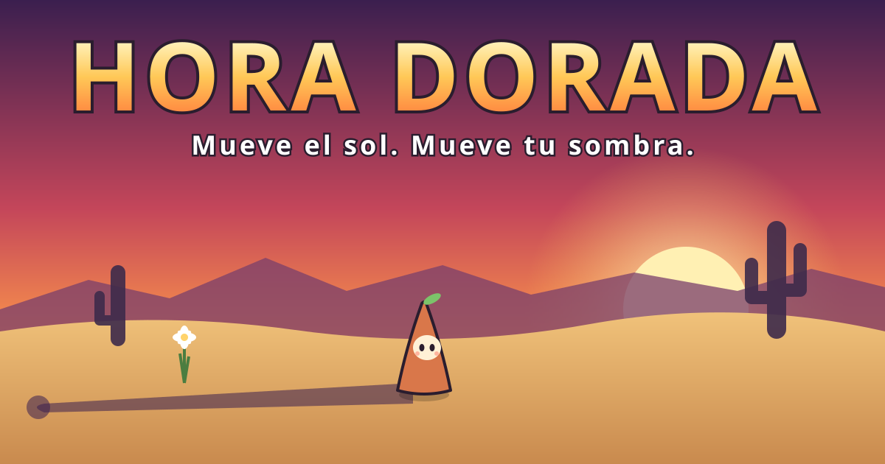
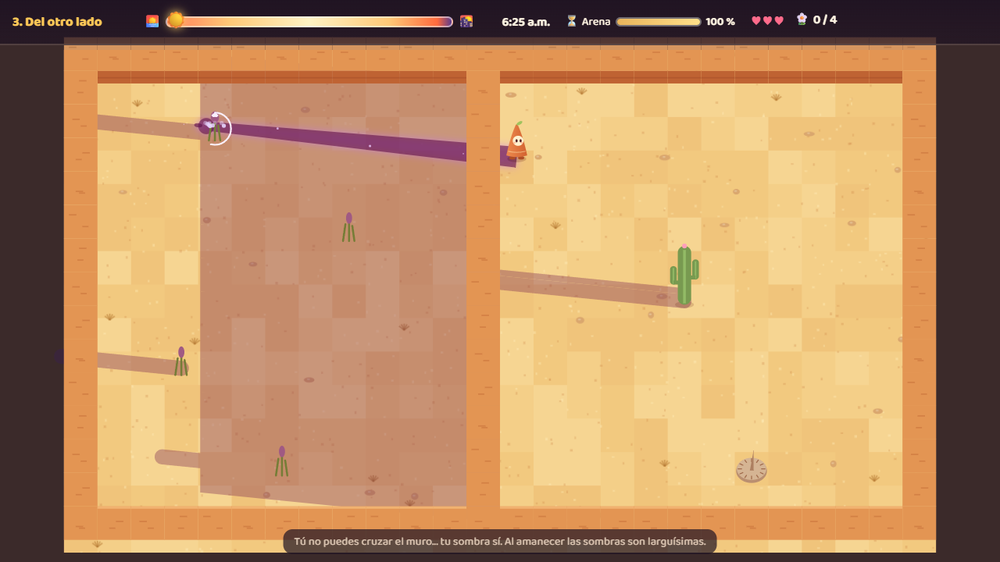
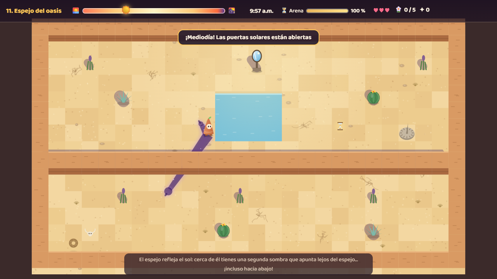

# HORA DORADA



> **Mueve el sol. Mueve tu sombra.**

**👉 [Jugar en línea](https://joeljorex.github.io/hora-dorada/)** · funciona en PC y en celular

Juego de rompecabezas para navegador hecho en JavaScript con Canvas 2D. Eres **Gno**, el espíritu de un viejo reloj de sol del desierto de Sonora. Las **flores de luna** solo abren cuando tu sombra las toca, y tú decides **a qué hora del día** cae.

## 📋 Datos

| | |
|---|---|
| **Escuela / grupo** | Universidad Tecnológica de Hermosillo (UTH) · IDGS 8-2 |
| **Materia / docente** | _(completar)_ |
| **Autor** | Joel Armando Ibarra Rubalcava |
| **Repositorio** | <https://github.com/joeljorex/hora-dorada> |
| **Proyecto (tarjetas)** | <https://github.com/joeljorex/hora-dorada/issues> |

## 📂 Documentación

| Documento | Archivo |
|---|---|
| 📘 Documento de Diseño de Juego (GDD) | [docs/GDD.md](docs/GDD.md) |
| 🖥️ Documento técnico (hardware y software) | [docs/Documento_tecnico.md](docs/Documento_tecnico.md) |
| 🎬 Storyboard | [img/storyboard.svg](img/storyboard.svg) |
| 🗺️ Mapa con comportamiento (nivel 4) | [img/mapa_nivel4_comportamiento.svg](img/mapa_nivel4_comportamiento.svg) |
| 🗺️ Bocetos de los 14 niveles | [img/mapas/](img/mapas/) |
| 🗂️ Tarjetas del proyecto | [tarjetas/tarjetas.json](tarjetas/tarjetas.json) · [issues](https://github.com/joeljorex/hora-dorada/issues) |

## 💡 Propuesta

En casi todos los juegos la sombra es decoración. Aquí es tu herramienta, y la apuntas **cambiando la hora del día**:

- 🌅 **Mañana:** el sol está al este; tu sombra es **larga** y apunta a la **izquierda**.
- ☀️ **Mediodía:** el sol está arriba; tu sombra es **cortita** y apunta hacia el norte.
- 🌇 **Tarde:** el sol está al oeste; tu sombra es **larga** y apunta a la **derecha**.

Con `Q` y `E` regresas o adelantas el sol, y eso gasta la **arena de tu reloj**. Si llega la noche antes de abrir todas las flores, pierdes.

| Amanecer: las flores abren | Del otro lado: la sombra cruza el muro |
|:---:|:---:|
|  |  |
| **Espejo del oasis: una sombra hacia abajo** | **Tres faroles: tres sombras** |
|  |  |
| **Nubes de agosto** | **Placas lunares** |
|  |  |

## ✨ Qué trae

- **14 niveles**, de día y de noche, cada uno con una idea nueva.
- Tu sombra **pasa sobre los muros**, aunque tú no puedas cruzarlos.
- **Placas lunares** que abren su puerta mientras tu sombra las cubre, y **sellos ☾** que se abren para siempre si cubres todos a la vez.
- **Puertas solares** que solo abren al mediodía.
- **Nubes:** bajo una nube no tienes sombra de sol.
- **Espejos solares:** te dan una segunda sombra, incluso hacia abajo.
- **De noche**, cada **farol** encendido te da otra sombra.
- **Destellos:** espíritus de luz que se apagan en tu sombra, pero te lastiman si te tocan.
- **Relojes de arena** para recoger: más arena de día y más vela de noche.
- **Puntaje** por eventos con desglose, **estrellas** y récord por nivel.
- **Vestuario:** sombrero de palma, paliacate, corona de flores y farolito. Se desbloquean con estrellas, y **tu sombra también se viste**.
- **Historia** al empezar, contada con las viñetas del storyboard.
- **Escenario del desierto:** saguaros, biznagas, agaves, ocotillos, cráneos, rodadoras con el viento, caminos de piedra, muros de adobe y oasis.
- **Música y efectos** generados con Web Audio: un tema de día y otro de noche.

| Historia | Vestuario | Puntaje |
|:---:|:---:|:---:|
|  |  |  |

## 🎮 Controles

| Acción | Teclado | Celular |
|---|---|---|
| Caminar | `W` `A` `S` `D` o flechas | Palanca |
| Regresar / adelantar el sol | `Q` / `E` o rueda del ratón | ◀☀️ / ☀️▶ |
| Estirarte (la sombra crece, no caminas) | `Espacio` | ⇑ |
| Prender o apagar un farol | `F` o `Enter` | F |
| Reiniciar / pausa / sonido | `R` / `Esc` / `M` | ⏸ |

## 🗺️ Niveles

| # | Nombre | Qué enseña |
|---|---|---|
| 1 | Amanecer | Tu sombra abre las flores |
| 2 | Adelanta el sol | Controlar la hora con la arena del reloj |
| 3 | Del otro lado | La sombra cruza muros; al amanecer es larguísima |
| 4 | Placas lunares | Puertas que se abren con la sombra a una hora exacta |
| 5 | Destellos | Enemigos de luz |
| 6 | Noche de faroles | Sombras que salen de los faroles |
| 7 | Dos sombras | Dos faroles, dos sombras, dos sellos al mismo tiempo |
| 8 | Hora dorada | Repaso: planear el día completo |
| 9 | Nubes de agosto | Nubes que quitan la sombra y relojes de arena |
| 10 | Puerta del mediodía | Puertas que solo abren a medio día |
| 11 | Espejo del oasis | Espejos que dan sombra hacia abajo |
| 12 | Biznagas | Laberinto con destellos y placa |
| 13 | Tres faroles | Tres sombras y un farol apagado |
| 14 | Último atardecer | El gran final: todo junto |

## 🧮 Puntaje

```
puntaje = 100·flores + 50·destellos + 200·sellos + 30·relojes − 50·golpes
        + 5·(% de arena restante) + 100·corazones + 2·máx(0, 180 − segundos)
```

Ganas ★★★ si te queda 50 % o más de arena (o vela). El detalle está en el [GDD §17](docs/GDD.md#17-score-cálculo-sobre-los-eventos).

## 🛠️ Cómo está hecho

- **JavaScript** con módulos ES y **Canvas 2D**, sin librerías ni archivos de imagen dentro del juego.
- **El sol:** dirección `(−cos πt, −sin πt)` y largo `altura / tan(elevación)`.
- **Sombras de faroles y espejos:** salen de una luz puntual; su largo crece con la distancia.
- **Sombras de muros y plantas:** envolvente convexa del bloque desplazado en la dirección del sol.
- **La noche:** una capa oscura con "huecos" de luz en cada farol (`destination-out`).
- **Verificador de niveles:** usa el mismo código del juego para comprobar que cada flor y cada placa se puede alcanzar.

```
hora-dorada/
├── index.html                 # pantallas, HUD y controles táctiles
├── css/estilo.css
├── js/
│   ├── main.js                # pantallas, controles, progreso, vestuario, historia y bucle
│   ├── juego.js               # lógica: sol, sombras, flores, placas, puertas, destellos, espejos, nubes, puntaje
│   ├── dibujo.js              # dibujo: Gno, escenario, sombras, luz del día y de la noche
│   ├── niveles.js             # los 14 niveles en texto
│   └── audio.js               # música y efectos
├── docs/                      # GDD y documento técnico
├── img/                       # splash, storyboard, mapas y capturas
├── herramientas/mapas_svg.py  # genera los bocetos de los niveles
└── tarjetas/tarjetas.json     # tarjetas del plan de trabajo
```

## ▶️ Jugarlo en tu computadora

```bash
cd hora-dorada
python -m http.server 8000
```

Luego entra a <http://localhost:8000>. Con `?todo` se desbloquean todos los niveles y vestimentas para probar.

## 👤 Autor

**Joel Armando Ibarra Rubalcava** · UTH · IDGS 8-2

Personaje, niveles, arte, música y efectos originales. Código con licencia [MIT](LICENSE).
