# HORA DORADA


> **Mueve el sol. Mueve tu sombra.**

**👉 [Jugar en línea](https://joeljorex.github.io/hora-dorada/)** · funciona en PC y en celular

Juego de rompecabezas en **3D** para navegador, hecho en JavaScript con **Three.js** y sprites pixel art gratuitos (CC0). Eres **Gno**, el espíritu de un viejo reloj de sol del desierto de Sonora. Las **flores de luna** solo abren cuando tu sombra las toca, y tú decides **a qué hora del día** cae.

## 📋 Datos

| | |
|---|---|
| **Escuela / grupo** | Universidad Tecnológica de Hermosillo (UTH) · IDGS 8-2 |
| **Materia / docente** | _(completar)_ |
| **Equipo** | Joel Armando Ibarra Rubalcava y Jorge Humberto Martínez Delgado |
| **Repositorio** | <https://github.com/joeljorex/hora-dorada> |
| **Proyecto (tarjetas)** | <https://github.com/joeljorex/hora-dorada/issues> |

## 📂 Documentación

| Documento | Archivo |
|---|---|
| 📘 Documento de Diseño de Juego (GDD) | [docs/GDD.md](docs/GDD.md) |
| 🖥️ Documento técnico (hardware y software) | [docs/Documento_tecnico.md](docs/Documento_tecnico.md) |
| 🎬 Storyboard | [img/storyboard.svg](img/storyboard.svg) |
| 🗺️ Mapa con comportamiento (nivel 4) | [img/mapa_nivel4_comportamiento.svg](img/mapa_nivel4_comportamiento.svg) |
| 🗺️ Bocetos de los 17 niveles | [img/mapas/](img/mapas/) |
| 🗂️ Tarjetas del proyecto | [tarjetas/tarjetas.json](tarjetas/tarjetas.json) · [issues](https://github.com/joeljorex/hora-dorada/issues) |

## 💡 Propuesta

En casi todos los juegos la sombra es decoración. Aquí es tu herramienta, y la apuntas **cambiando la hora del día**:

- 🌅 **Mañana:** el sol está al este; tu sombra es **larga** y apunta a la **izquierda**.
- ☀️ **Mediodía:** el sol está arriba; tu sombra es **cortita** y apunta hacia el norte.
- 🌇 **Tarde:** el sol está al oeste; tu sombra es **larga** y apunta a la **derecha**.

Con `Q` y `E` regresas o adelantas el sol. La **arena de tu reloj es tu tiempo**: baja sola cada segundo y más rápido al mover el sol. **Si se acaba, pierdes al instante** (y también si llega la noche).

| Título | Amanecer: las flores abren |
|:---:|:---:|
| 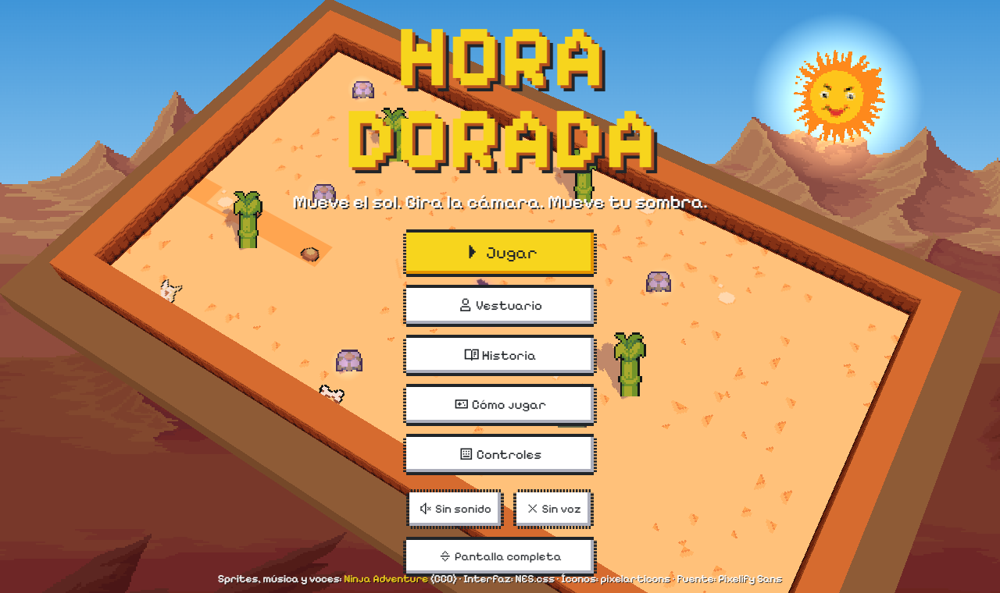 | 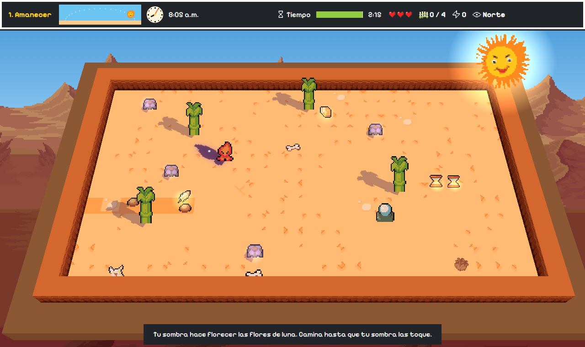 |
| **Cámara girada: la sombra cae hacia otro lado** | **Mesetas: desde lo alto la sombra llega lejos** |
| 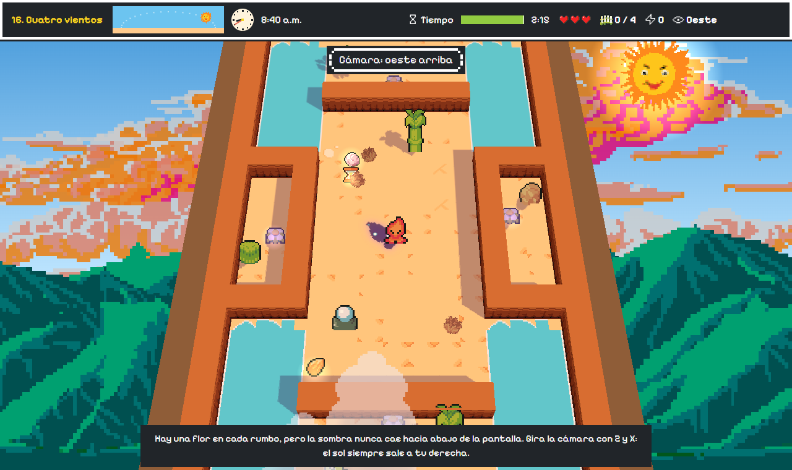 | 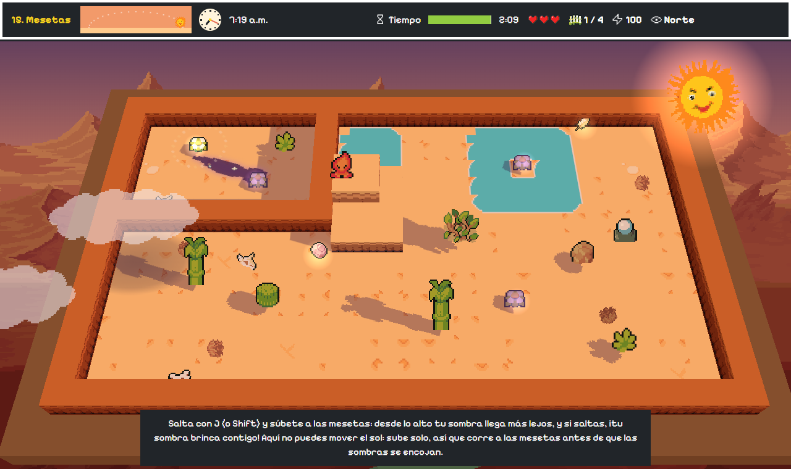 |
| **Plataformas sobre el oasis** | **Tres faroles: tres sombras** |
| 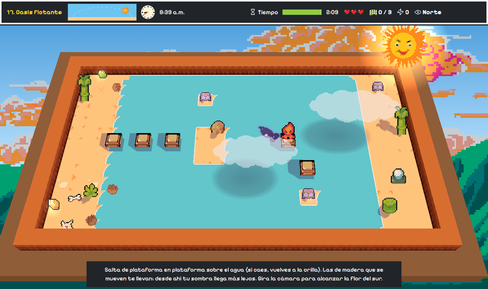 | 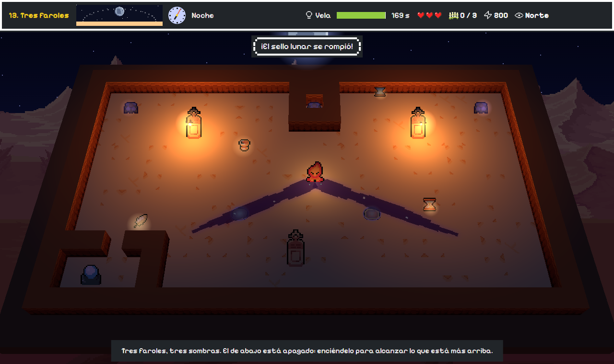 |
| **Nubes de agosto** | **Placas lunares** |
| 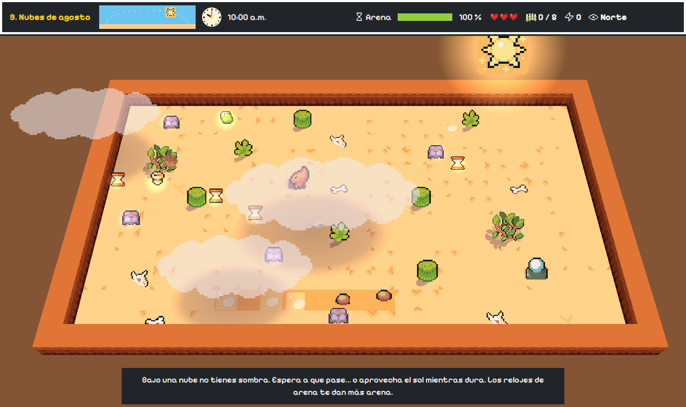 | 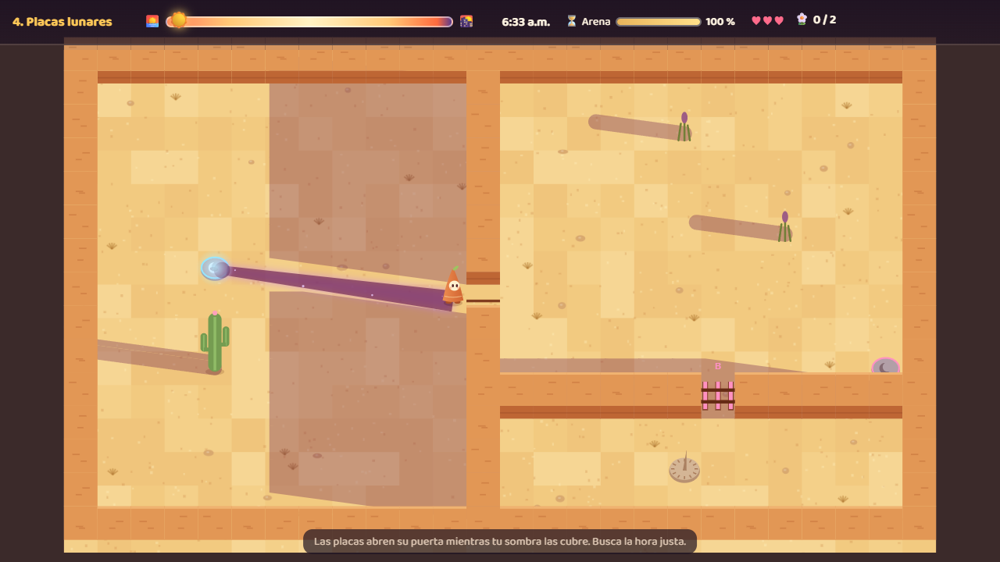 |

## ✨ Qué trae

- **17 niveles**, de día y de noche, cada uno con una idea nueva.
- **Cada intento es distinto:** aparecen **ventajas aleatorias** (sombra larga, prisa, tiempo quieto, salto alto, escudo, corazón, doble puntos y semilla mágica), cada nivel trae un **evento** al azar (brisa, día veloz, lluvia de ventajas, tesoro de arena o destellos inquietos) y un **reto** opcional con premio.
- **Fondo con montañas según el entorno:** desierto rocoso, oasis con río, montañas verdes con nubes en los niveles con mucha agua, y cielo estrellado de noche. El cielo cambia con la hora y las montañas se desplazan al girar la cámara.
- **Pantalla completa y celulares:** botón de pantalla completa; en Android y iPhone se adapta a cualquier pantalla (zonas seguras, HUD compacto, controles táctiles) y se puede **instalar como app** desde el menú del navegador (*Agregar a pantalla de inicio*).
- **Sol y reloj:** el sol (o la luna) cruza el cielo con la hora, y el HUD muestra el cielo y un reloj de manecillas que avanzan con el tiempo y con `Q` / `E`.
- **Plataformas:** de madera, fijas o que se mueven sobre el agua. Gno salta de una a otra, las plataformas lo llevan y, si cae al agua, vuelve a tierra firme.
- **Controles configurables:** cada acción se puede reasignar en el menú **Controles** (se guarda en el navegador).
- **Cámara 3D:** la cámara gira alrededor del mundo (`Z` / `X`) y sube o baja (`C`). El sol siempre sale a la derecha de la cámara, así que **al girarla tu sombra cae hacia otro lado del mapa** y alcanzas flores desde otra perspectiva.
- **Estudio de voces:** `Estudio de voces.bat` abre una app que muestra el [libreto](docs/Libreto_voces.md), graba cada frase con el micrófono, deja revisarla y la envía al juego.
- **Voz natural:** Gno y el narrador hablan con voces grabadas con **Piper** (TTS neuronal libre). La música baja mientras hablan. En el nivel 1 Gno dice los controles y el narrador presenta cada nivel.
- **Interfaz de librerías:** NES.css (botones y paneles), pixelarticons (íconos), Pixelify Sans (fuente) y teclas en sprite del paquete.
- **Mecánica 3D:** Gno **salta** y se sube a **mesetas de roca**; desde lo alto su sombra llega más lejos y, al saltar, la sombra se despega de sus pies.
- **Sprites y animaciones** del paquete gratuito [Ninja Adventure](https://pixel-boy.itch.io/ninja-adventure-asset-pack) (CC0): personaje que camina en 4 direcciones y salta, destellos animados, flores, faroles con llama y efectos mágicos.
- Tu sombra **pasa sobre los muros**, aunque tú no puedas cruzarlos.
- **Placas lunares** que abren su puerta mientras tu sombra las cubre, y **sellos ☾** que se abren para siempre si cubres todos a la vez.
- **Puertas solares** que solo abren al mediodía.
- **Nubes:** bajo una nube no tienes sombra de sol.
- **Espejos solares:** te dan una segunda sombra, incluso hacia abajo.
- **De noche**, cada **farol** encendido te da otra sombra.
- **Destellos:** espíritus de luz que se apagan en tu sombra, pero te lastiman si te tocan.
- **Relojes de arena** para recoger: más arena de día y más vela de noche.
- **Puntaje** por eventos con desglose, **estrellas** y récord por nivel.
- **Vestuario:** cinco disfraces de Gno (sombrero de palma, paliacate, flor en el pelo y espíritu de luz) que se desbloquean con estrellas, y **tu sombra también se viste**.
- **Historia** al empezar, contada con las viñetas del storyboard.
- **Escenario del desierto:** saguaros, biznagas, agaves, ocotillos, cráneos, rodadoras con el viento, caminos de piedra, muros de adobe, mesetas y oasis.
- **Música y efectos** del mismo paquete: tema de título, de día, de noche y de la historia.

| Historia | Vestuario | Puntaje |
|:---:|:---:|:---:|
| 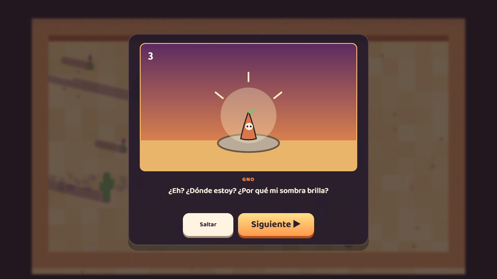 | 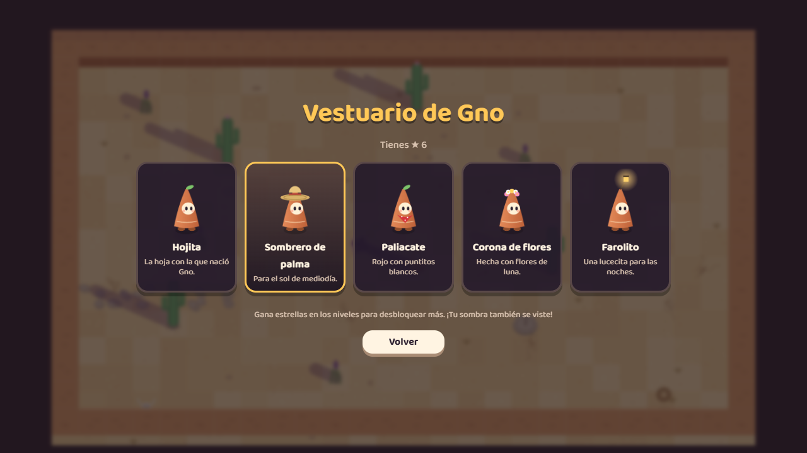 | 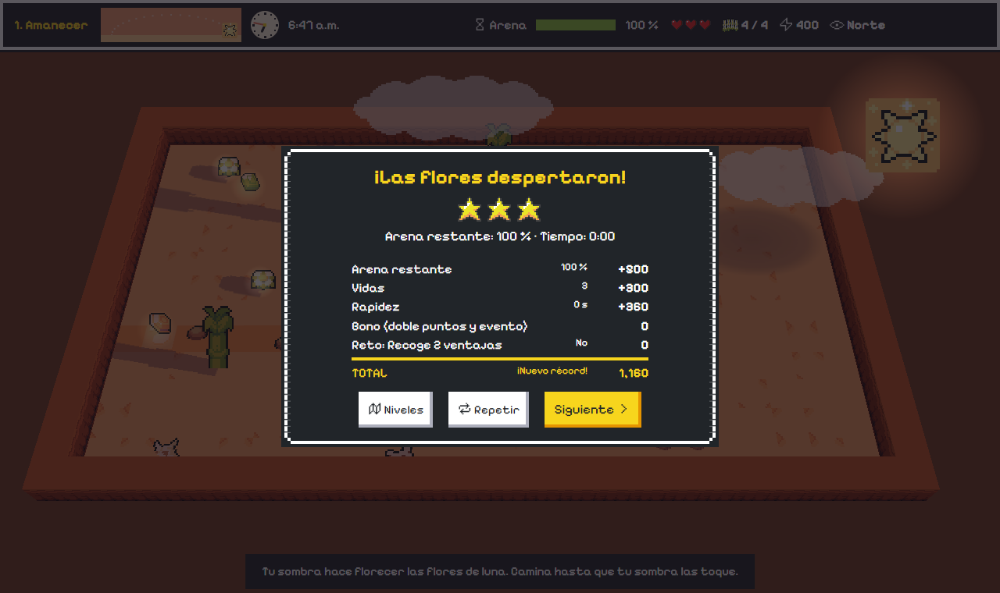 |

## 🎮 Controles

| Acción | Teclado | Celular |
|---|---|---|
| Caminar | `W` `A` `S` `D` o flechas | Palanca |
| Regresar / adelantar el sol | `Q` / `E` o rueda del ratón | ◀☀️ / ☀️▶ |
| Estirarte (la sombra crece, no caminas) | `Espacio` | ⇑ |
| Saltar (y subirte a las mesetas) | `J` o `Shift` | ⤒ |
| Girar la cámara alrededor del mundo | `Z` / `X` | ↺ / ↻ |
| Cámara alta / baja | `C` | 👁 |
| Prender o apagar un farol | `F` o `Enter` | F |
| Reiniciar / pausa / sonido | `R` / `Esc` / `M` | ⏸ |

## 🗺️ Niveles

| # | Nombre | Qué enseña |
|---|---|---|
| 1 | Amanecer | Tu sombra abre las flores |
| 2 | Adelanta el sol | Controlar la hora con la arena del reloj |
| 3 | Del otro lado | La sombra cruza muros; al amanecer es larguísima |
| 4 | Placas lunares | Puertas que se abren con la sombra a una hora exacta |
| 5 | Destellos | Enemigos de luz |
| 6 | Noche de faroles | Sombras que salen de los faroles |
| 7 | Dos sombras | Dos faroles, dos sombras, dos sellos al mismo tiempo |
| 8 | Hora dorada | Repaso: planear el día completo |
| 9 | Nubes de agosto | Nubes que quitan la sombra y relojes de arena |
| 10 | Puerta del mediodía | Puertas que solo abren a medio día |
| 11 | Espejo del oasis | Espejos que dan sombra hacia abajo |
| 12 | Biznagas | Laberinto con destellos y placa |
| 13 | Tres faroles | Tres sombras y un farol apagado |
| 14 | Último atardecer | El gran final: todo junto |
| 15 | Mesetas | Saltar y alargar la sombra desde lo alto |
| 16 | Cuatro vientos | Cámara 3D: girar la vista para que la sombra caiga hacia el sur |
| 17 | Oasis flotante | Plataformas fijas y móviles sobre el agua |

## 🧮 Puntaje

```
puntaje = 100·flores + 50·destellos + 200·sellos + 30·relojes − 50·golpes
        + 5·(% de arena restante) + 100·corazones + 2·máx(0, 180 − segundos)
```

Ganas ★★★ si te queda 50 % o más de arena (o vela). El detalle está en el [GDD §17](docs/GDD.md#17-score-cálculo-sobre-los-eventos).

## 🛠️ Cómo está hecho

- **JavaScript** con módulos ES. El mundo se dibuja en 3D con **Three.js**: muros y mesetas son cajas, y las plantas y personajes son sprites que miran a la cámara. El piso es una textura que se pinta en Canvas 2D con las sombras que calcula el juego.
- **Librerías** en `lib/` (Three.js, NES.css, pixelarticons) y recursos CC0 en `assets/` (ver [créditos](assets/CREDITOS.md)).
- **Cámara y sol:** la dirección de la sombra se calcula respecto a la pantalla y se pasa al mapa según hacia dónde mira la cámara (`dirAMapa`).
- **Eje Z:** Gno tiene altura y gravedad; la sombra del sol va de `z / tan(e)` a `(z + 1.4) / tan(e)`.
- **Sombras con sprites:** la silueta de cada sprite se proyecta en el suelo con una transformación afín, así que la sombra camina, salta y se viste igual que Gno.
- **El sol:** dirección `(−cos πt, −sin πt)` y largo `altura / tan(elevación)`.
- **Sombras de faroles y espejos:** salen de una luz puntual; su largo crece con la distancia.
- **Sombras de muros y plantas:** envolvente convexa del bloque desplazado en la dirección del sol.
- **La noche:** una capa oscura con "huecos" de luz en cada farol (`destination-out`).
- **Verificador de niveles:** usa el mismo código del juego para comprobar que cada flor y cada placa se puede alcanzar.

```
hora-dorada/
├── index.html                 # pantallas, HUD y controles táctiles
├── css/estilo.css
├── js/
│   ├── main.js                # pantallas, controles, progreso, vestuario, historia y bucle
│   ├── juego.js               # lógica: sol, sombras, flores, placas, puertas, destellos, espejos, nubes, puntaje
│   ├── dibujo.js              # dibujo con sprites: Gno, escenario, sombras, luz del día y de la noche
│   ├── sprites.js             # carga de sprites, recortes y animaciones
│   ├── mundo3d.js             # mundo 3D y cámara giratoria (Three.js)
│   ├── historia.js            # historia con escenas de sprites y cuadro de diálogo
│   ├── voz.js                 # voces grabadas con Piper (y respaldo con Web Speech API)
│   ├── controles.js           # asignación de teclas que el jugador puede cambiar
│   ├── iconos.js              # íconos de pixelarticons
│   ├── niveles.js             # los 15 niveles en texto
│   └── audio.js               # música (MP3) y efectos (WAV)
├── assets/                    # sprites, música, efectos y voces CC0 (Ninja Adventure) y CREDITOS.md
├── lib/                       # Three.js, NES.css y pixelarticons (MIT)
├── docs/                      # GDD y documento técnico
├── img/                       # splash, storyboard, mapas y capturas
├── herramientas/mapas_svg.py  # genera los bocetos de los niveles
└── tarjetas/tarjetas.json     # tarjetas del plan de trabajo
```

## ▶️ Jugarlo en tu computadora

```bash
cd hora-dorada
python -m http.server 8000
```

Luego entra a <http://localhost:8000>. Con `?todo` se desbloquean todos los niveles y vestimentas para probar.

## 👥 Equipo

| Integrante | Rol |
|---|---|
| **Joel Armando Ibarra Rubalcava** | Programación, Git y diseño de niveles |
| **Jorge Humberto Martínez Delgado** | Arte, audio, QA y documentación |

UTH · IDGS 8-2

Concepto, mecánicas, niveles e historia originales. Sprites, animaciones, música, efectos y voces: **Ninja Adventure** de Pixel-boy y AAA, licencia CC0. Librerías: Three.js, NES.css y pixelarticons (MIT), fuente Pixelify Sans (OFL) ([créditos](assets/CREDITOS.md)). Código con licencia [MIT](LICENSE).
