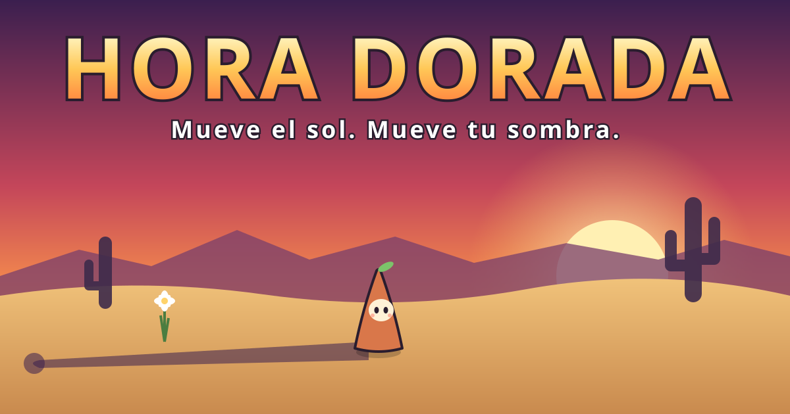
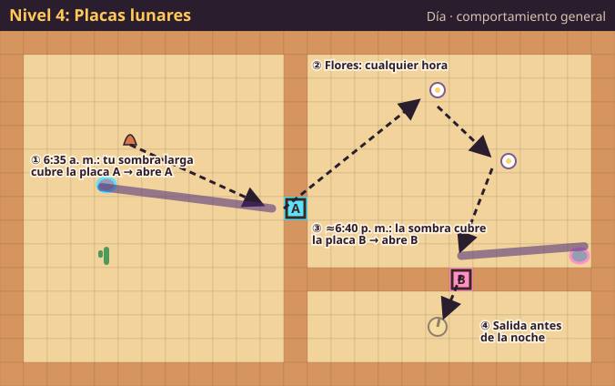
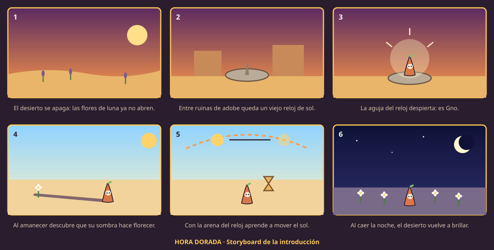

# Documento de Diseño de Juego (GDD) · HORA DORADA



## 1. Portada

| | |
|---|---|
| **Juego** | Hora Dorada |
| **Escuela / grupo** | Universidad Tecnológica de Hermosillo (UTH) · IDGS 8-2 |
| **Materia / docente** | _(completar)_ |
| **Fecha** | Noviembre de 2026 |
| **Versión del documento** | 1.0 |

| Foto | Integrante | Rol |
|:---:|---|---|
|  | **Joel Armando Ibarra Rubalcava** | Diseño, programación, arte, audio y documentación |

## 2. Nombre del juego

**HORA DORADA**. En fotografía, la *hora dorada* es el rato después del amanecer y antes del atardecer, cuando el sol está bajo y las sombras son más largas. En el juego es justo cuando tu sombra alcanza más lejos.

## 3. Enlaces

| | |
|---|---|
| Repositorio | <https://github.com/joeljorex/hora-dorada> |
| Jugar en línea | <https://joeljorex.github.io/hora-dorada/> |
| Proyecto (tarjetas) | <https://github.com/joeljorex/hora-dorada/issues> |

## 4. Concepto

Juego de rompecabezas en 2D visto desde arriba. Controlas a **Gno**, el espíritu de un reloj de sol, y tu única herramienta es **tu sombra**. Para apuntarla **cambias la hora del día**: si adelantas o regresas el sol, la sombra cambia de dirección y de largo. Con ella haces florecer las flores de luna, activas placas, rompes sellos y apagas espíritus de luz.

> **Frase de venta:** "Mueve el sol. Mueve tu sombra."

**Lo novedoso:** en casi todos los juegos la sombra es decoración. Aquí es el control principal, y se usa con una regla que todos conocemos de la vida real: la sombra es larga en la mañana y en la tarde, y corta al mediodía.

## 5. Género

- **Principal:** rompecabezas (*puzzle*) de lógica espacial.
- **Secundario:** acción ligera, porque hay que esquivar destellos y el tiempo corre.
- **Formato:** niveles cortos (de 1 a 4 minutos) con estrellas y puntaje para volver a jugarlos.

## 6. Público objetivo

| | |
|---|---|
| **Edad** | De 8 años en adelante. Clasificación sugerida: **E (Todos)**. No tiene violencia; los "enemigos" se apagan en la sombra. |
| **Perfil** | Jugadores casuales que disfrutan pensar (rompecabezas, juegos de lógica) y estudiantes. |
| **Plataforma** | Navegador web en PC (teclado y ratón) y celular (controles táctiles). |
| **Por qué les gusta** | La regla se entiende en segundos y cada nivel agrega una idea nueva. Se puede volver a jugar para conseguir 3★ y más puntos. |

## 7. Historia

En el desierto de Sonora crecen las **flores de luna**, que solo abren de noche. Un verano, el desierto se apagó: las flores dejaron de abrir y el valle perdió su brillo.

Entre unas ruinas de adobe quedaba un viejo reloj de sol. Su aguja, el *gnomon*, llevaba siglos marcando la hora con su sombra. Una tarde, la aguja despertó convertida en un pequeño espíritu: **Gno**.

Gno descubrió que su sombra guarda un poco de la noche. Si toca a una flor de luna, la flor abre. Además, con la arena de su reloj puede **mover el sol**: regresar la mañana o adelantar la tarde para que su sombra llegue a donde él no puede.

Así recorre el desierto: campos de saguaros, oasis con espejos, laberintos de biznagas y noches de faroles, hasta llegar al **último atardecer**, donde debe usar todo lo aprendido para que el valle vuelva a brillar.

## 8. Personajes

| Personaje | Descripción | Comportamiento |
|---|---|---|
| **Gno** (protagonista) | Espíritu nacido de la aguja de un reloj de sol. Cuerpo de barro en forma de triángulo, cara redonda color crema, mejillas rosadas y una hojita en la punta. | Camina, se estira para alargar su sombra y mueve el sol con la arena de su reloj. |
| **Destellos** (obstáculo) | Pequeños espíritus de luz pura: esferas amarillas con rayos. | Patrullan en línea recta y se dan la vuelta al chocar o al encontrar sombra de muros. Si tocan a Gno, le quitan un corazón. Se apagan dentro de la sombra de Gno. |
| **Flores de luna** (objetivo) | Inspiradas en la "reina de la noche", un cactus real del desierto sonorense que florece de noche. Botón morado que se abre en una flor blanca brillante. | Se abren si la sombra de Gno las cubre un momento. Cuando abren todas, se activa el reloj de sol de salida. |

## 9. Mecánicas

### 9.1 El sol y la sombra

La hora va de `t = 0` (amanecer, 6:00 a. m.) a `t = 1` (anochecer, 7:00 p. m.).

- **Dirección de la sombra:** `(−cos πt, −sin πt)`. En la mañana apunta a la izquierda (oeste), al mediodía hacia arriba (norte) y en la tarde a la derecha (este). Nunca apunta hacia abajo (sur).
- **Elevación del sol:** `e = 1.25 · sin(πt)` radianes.
- **Largo de la sombra:** `altura / tan(e)`, con un máximo de 12 casillas. Gno mide 1.4; estirado mide 1.95.

| Hora | Largo de la sombra de Gno |
|---|---|
| 6:39 a. m. (`t = 0.05`) | 7.1 casillas |
| 7:18 a. m. (`t = 0.10`) | 3.5 casillas |
| 12:30 p. m. (`t = 0.50`) | 0.5 casillas |

### 9.2 Reglas

1. Tu sombra **pasa por encima de los muros**; tú no puedes cruzarlos.
2. `Q` / `E` mueven el sol y gastan **arena** (1 segundo de arena por segundo de uso). El día también avanza solo.
3. Si llega la **noche** antes de abrir todas las flores, pierdes.
4. **Placas lunares:** abren su puerta mientras tu sombra las cubre.
5. **Sellos ☾:** si cubres todos a la vez, su puerta se abre para siempre.
6. **Puertas solares:** solo están abiertas al mediodía (de 11:12 a. m. a 1:48 p. m.).
7. **Nubes:** bajo una nube no tienes sombra de sol.
8. **Espejos solares:** reflejan el sol y te dan una **segunda sombra** que apunta lejos del espejo. Es la única forma de tener sombra hacia abajo de día.
9. **Noche:** no hay sol; cada **farol** encendido te da su propia sombra. Las velas se gastan con el tiempo.
10. Tienes **3 corazones**: si los destellos te los quitan todos, pierdes.

### 9.3 Controles

| Acción | Teclado | Celular |
|---|---|---|
| Caminar | `W` `A` `S` `D` / flechas | Palanca |
| Regresar / adelantar el sol | `Q` / `E` o rueda del ratón | ◀☀️ / ☀️▶ |
| Estirarse | `Espacio` | ⇑ |
| Prender o apagar un farol | `F` / `Enter` | F |
| Reiniciar / pausa / sonido | `R` / `Esc` / `M` | ⏸ |

## 10. Niveles

Hay 14 niveles. Cada uno presenta una idea nueva y la combina con las anteriores.

| # | Nombre | Momento | Idea nueva |
|---|---|---|---|
| 1 | Amanecer | Día | Tu sombra abre las flores |
| 2 | Adelanta el sol | Día | Mover la hora con la arena |
| 3 | Del otro lado | Día | La sombra cruza muros; al amanecer es larguísima |
| 4 | Placas lunares | Día | Puertas que se abren a una hora exacta |
| 5 | Destellos | Día | Enemigos de luz |
| 6 | Noche de faroles | Noche | Sombras de los faroles |
| 7 | Dos sombras | Noche | Dos sellos a la vez con dos faroles |
| 8 | Hora dorada | Día | Repaso: planear el día completo |
| 9 | Nubes de agosto | Día | Nubes que quitan la sombra y relojes de arena |
| 10 | Puerta del mediodía | Día | Puertas solares |
| 11 | Espejo del oasis | Día | Espejos que dan sombra hacia abajo |
| 12 | Biznagas | Día | Laberinto con destellos y placa |
| 13 | Tres faroles | Noche | Tres sombras y un farol apagado |
| 14 | Último atardecer | Día | Gran final: todo junto |

### 10.1 Mapa bocetado con su comportamiento (Nivel 4: Placas lunares)



1. Gno empieza a la izquierda. A las **6:35 a. m.** su sombra es tan larga que, parado junto a la puerta **A**, alcanza la **placa A** y la puerta se abre.
2. Del otro lado abre las dos flores (cualquier hora sirve).
3. La puerta **B** necesita que la sombra apunte a la derecha, lo que pasa **al atardecer (≈6:40 p. m.)**. Hay que esperar o gastar arena para llegar a esa hora.
4. Con la puerta B abierta, corre al reloj de sol antes de que caiga la noche.

Los mapas de los 14 niveles están en [`img/mapas/`](../img/mapas/) y se generan con `herramientas/mapas_svg.py` a partir de `js/niveles.js`.

## 11. Armas

Hora Dorada no tiene armas de daño. Las "armas" son herramientas de luz y sombra:

| Herramienta | Qué hace |
|---|---|
| **Sombra de Gno** | Abre flores, activa placas y sellos, y apaga destellos (en 0.5 s). |
| **Reloj de arena (Q/E)** | Cambia la hora: dirección y largo de la sombra. |
| **Estirarse (Espacio)** | Hace la sombra 40 % más larga, pero no puedes caminar. |
| **Faroles (F)** | De noche, cada farol encendido da una sombra extra. |
| **Espejos solares** | De día, dan una segunda sombra en otra dirección. |

## 12. Vestimenta

Gno desbloquea ropa con las estrellas que gana. **La ropa también aparece en su sombra:** el sombrero hace una sombra más ancha y la corona una sombra con picos.

| Vestimenta | Se desbloquea con | Descripción |
|---|---|---|
| Hojita | Desde el inicio | La hoja con la que nació Gno |
| Sombrero de palma | 6 ★ | Para el sol de mediodía |
| Paliacate | 12 ★ | Rojo con puntitos blancos |
| Corona de flores | 20 ★ | Hecha con flores de luna |
| Farolito | 30 ★ | Una lucecita para las noches |

## 13. Objetos especiales (props y fondo)

**Interactivos**

| Objeto | Función |
|---|---|
| Flor de luna | Objetivo: se abre con tu sombra |
| Reloj de sol | Salida; brilla cuando todas las flores abren |
| Placa lunar (A/B) | Abre su puerta mientras la cubres |
| Sello lunar ☾ | Abre su puerta para siempre si cubres todos a la vez |
| Puerta de madera (A/B) | Se abre con su placa |
| Puerta de piedra ☾ | Se abre con los sellos |
| Puerta solar | Abierta solo al mediodía |
| Espejo solar | Da una segunda sombra |
| Farol | Da sombra de noche; se prende y apaga |
| Reloj de arena | +2 s de arena (de día) o +20 s de vela (de noche) |

**Escenario y fondo**

- **Obstáculos con sombra:** muros de adobe, muros bajos, saguaros, biznagas, agaves, ocotillos, rocas y agua del oasis.
- **Adornos:** cráneos de vaca, caminos de piedra, tierra agrietada, matorrales secos y **rodadoras** que cruzan con el viento.
- **Cielo y luz:** el color de la escena cambia con la hora. El amanecer es rosado, el mediodía blanco, la tarde naranja y la noche azul con huecos de luz en cada farol. Las **nubes** proyectan su sombra sobre el suelo y se ven pasar por arriba.

## 14. Arte

- **Estilo:** 2D vista desde arriba con objetos en perspectiva 3/4. Colores planos y cálidos.
- **Paleta:** arena `#efcf94`, adobe `#d6955f`, saguaro `#4e9a5b`, sombra mágica violeta `#30124f`, oro `#ffc857`.
- **Técnica:** todo se dibuja con código en Canvas 2D (figuras, gradientes y transparencias). No hay archivos de imagen dentro del juego.

## 15. Storyboard



1. El desierto se apaga y las flores de luna ya no abren.
2. Entre ruinas de adobe queda un viejo reloj de sol.
3. La aguja del reloj despierta: es Gno.
4. Al amanecer, Gno descubre que su sombra hace florecer.
5. Con la arena del reloj aprende a mover el sol.
6. Al caer la noche, el desierto vuelve a brillar.

## 16. Guion

**Introducción** (se muestra con el storyboard)

> **Narrador:** Hace mucho que las flores de luna no abren. El desierto se está quedando a oscuras.
> **Narrador:** Pero entre las ruinas, la vieja aguja del reloj de sol sigue marcando la hora…
> **Gno:** ¿Eh? ¿Dónde estoy? ¿Por qué mi sombra brilla?
> **Narrador:** Tu sombra guarda un poco de la noche, Gno. Llévala hasta las flores.
> **Gno:** ¿Y si la sombra no alcanza?
> **Narrador:** Mueve el sol. Para eso tienes la arena de tu reloj.

**Durante el juego** (pistas al empezar cada nivel)

- *Amanecer:* "Tu sombra hace florecer las flores de luna. Camina hasta que tu sombra las toque."
- *Del otro lado:* "Tú no puedes cruzar el muro… tu sombra sí."
- *Espejo del oasis:* "El espejo refleja el sol: cerca de él tienes una segunda sombra."
- Al abrir todas las flores: "¡Todas las flores abrieron! El reloj de sol te espera."
- Al perder: "Se hizo de noche antes de terminar" o "Los destellos te deshicieron".

**Final** (después del nivel 14)

> **Gno:** ¿Ya? ¿Lo logramos?
> **Narrador:** Mira a tu alrededor.
> *(Todas las flores brillan bajo la luna.)*
> **Gno:** Entonces puedo descansar… hasta el próximo amanecer.

## 17. Score (cálculo sobre los eventos)

Los puntos se calculan con lo que pasa en cada nivel (constante `PUNTOS` en `js/juego.js`):

| Evento | Puntos |
|---|---|
| Flor de luna abierta | +100 c/u |
| Destello apagado | +50 c/u |
| Sello lunar roto | +200 c/u |
| Reloj de arena recogido | +30 c/u |
| Golpe recibido | −50 c/u |
| Arena (o vela) restante | +5 por cada 1 % |
| Corazones al terminar | +100 c/u |
| Rapidez | +2 por cada segundo menos de 180 |

**Fórmula**

```
puntaje = 100·flores + 50·destellos + 200·sellos + 30·relojes − 50·golpes
        + 5·(% de arena restante) + 100·corazones + 2·máx(0, 180 − segundos)
```

**Ejemplo:** 5 flores, 2 destellos, 1 reloj, 1 golpe, 60 % de arena, 2 corazones y 95 segundos:
`500 + 100 + 30 − 50 + 300 + 200 + 170 = 1250 puntos`.

**Estrellas:** ★★★ si te queda 50 % o más de arena (o vela), ★★ si te queda 20 % o más y ★ si terminas con menos. El mejor puntaje y las estrellas de cada nivel se guardan en el navegador.

## 18. Música

| Tema | Cuándo suena | Descripción |
|---|---|---|
| **"Arena tibia"** | Niveles de día y título | 88 BPM. Arpegio tranquilo en onda triangular sobre la escala pentatónica de la menor, con bajo suave y campanitas ocasionales. Da calma para pensar. |
| **"Velas"** | Niveles de noche | 70 BPM. Arpegio en onda senoidal, más lento y espaciado, con acordes que suenan a noche. |

Toda la música se genera en tiempo real con **Web Audio API** (osciladores y filtros), sin archivos de audio.

## 19. Efectos de audio

| Evento | Sonido |
|---|---|
| Flor creciendo / abriendo | Tono que sube / arpegio brillante de 4 notas |
| Todas las flores abiertas | Acorde largo ascendente |
| Mover el sol | "Arena" continua (ruido filtrado más agudo al adelantar) |
| Placa activada / desactivada | Campana grave / tono que baja |
| Puerta de madera / sello de piedra | Golpe seco de madera / roca que se arrastra con acorde |
| Destello apagado | Barrido agudo hacia abajo con chispa |
| Golpe a Gno | Tono áspero que baja |
| Farol / reloj de arena | Chispa con tono / tres campanitas |
| Estirarse | Tono corto que sube |
| Ganar / perder | Fanfarria de 7 notas / melodía que baja |

## 20. Propuesta de plan de trabajo (técnico Git)

**Organización:** el trabajo se divide en tarjetas (issues) de GitHub con etiquetas `diseño`, `programación`, `arte`, `audio`, `niveles`, `documentación` y `git`, agrupadas en 4 sprints de una semana.

| Sprint | Objetivo | Entregables |
|---|---|---|
| 1 | Prototipo de la mecánica | Sol y sombra, movimiento y colisiones, nivel de prueba |
| 2 | Contenido base | Niveles 1–8, flores, placas, sellos, destellos, faroles, HUD |
| 3 | Expansión | Niveles 9–14, nubes, espejos, puerta solar, relojes, vestimenta, puntaje |
| 4 | Pulido y entrega | Audio, versión celular, pruebas de solución de niveles, GDD, README, GitHub Pages |

**Flujo de ramas**

```
main  ←  develop  ←  feature/<número>-<descripción>
```

- `main` es la versión publicada en GitHub Pages; solo recibe lo que ya se probó en `develop`.
- Cada tarjeta se trabaja en su rama `feature/` y se une a `develop` con un *pull request*.
- Los commits siguen *Conventional Commits* con el número de tarjeta, por ejemplo:
  - `feat(niveles): agrega Espejo del oasis (#11)`
  - `fix(sombra): la placa no cuenta si estás encima (#7)`
  - `docs(gdd): sección de score (#20)`
- **Publicación:** GitHub Pages sirve la rama `main` desde la raíz del repositorio.
- **Pruebas:** antes de unir una rama se corre el verificador de niveles, que comprueba con el código del juego que cada flor y cada placa se puede alcanzar.

## 21. Créditos

| | |
|---|---|
| Diseño, programación, arte, audio y documentación | **Joel Armando Ibarra Rubalcava** |
| Fuente tipográfica | *Baloo 2* (Ek Type), licencia SIL Open Font License, vía Google Fonts |
| Tecnologías | JavaScript, Canvas 2D, Web Audio API, GitHub Pages |
| Inspiración real | La flor "reina de la noche" (*Peniocereus greggii*) y el desierto de Sonora |

Personaje, niveles, arte, música y efectos son originales. El código se publica con licencia MIT.
